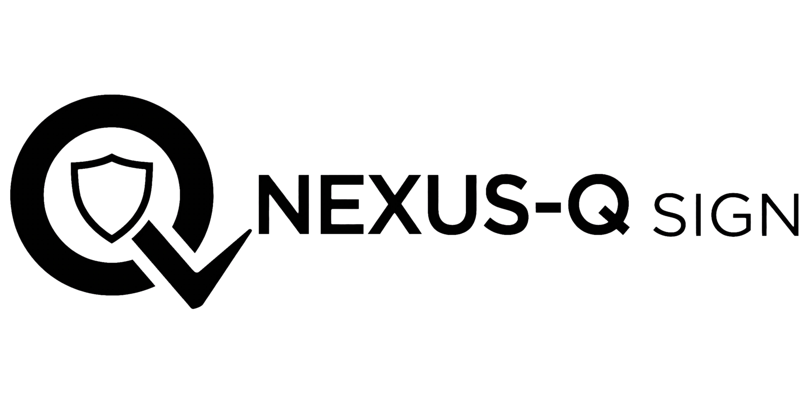
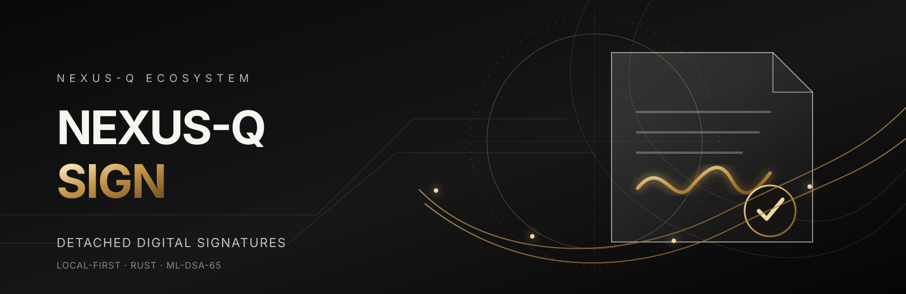
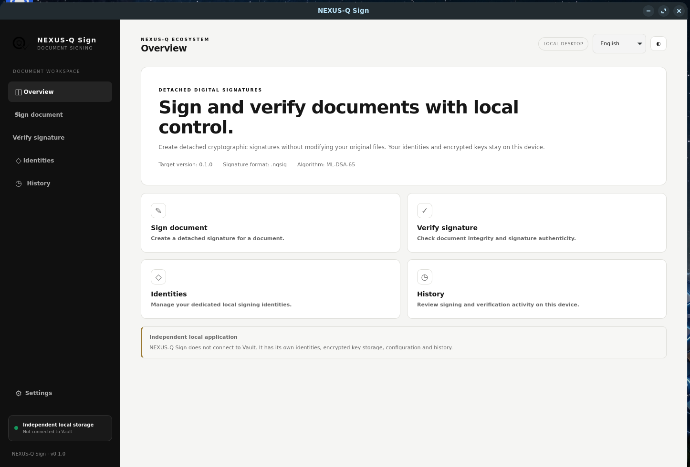
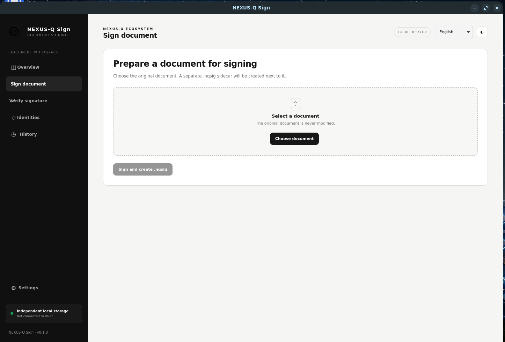
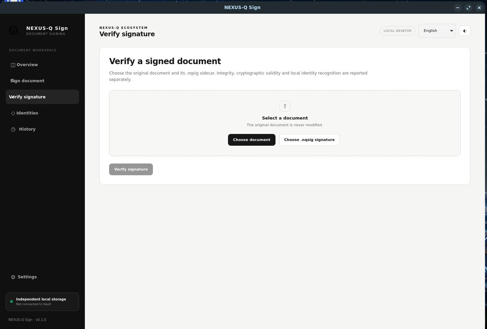
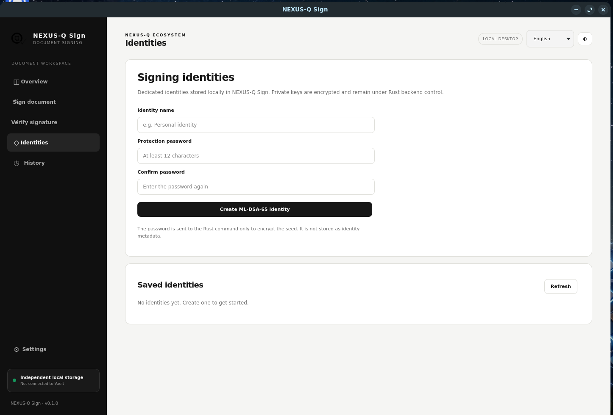
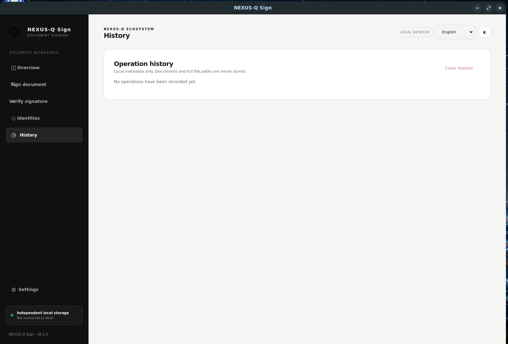

<p align="center">
  
</p>

<p align="center">
  <a href="https://github.com/lecodev-26/nexus-q-sign/actions/workflows/build.yml"></a>
  
  
  
  
  
  
</p>

# NEXUS-Q Sign

**Local-first detached document signing and verification.**

NEXUS-Q Sign is an independent desktop application for creating and verifying detached digital signatures. It is built with **Rust, Tauri 2, Svelte 5, TypeScript and Vite**. The original document remains untouched; a signature is stored in a separate `.nqsig` sidecar file.

> **Development status:** version 0.1.0 is an early development milestone. Cross-platform packaging, end-to-end validation and an independent security review are not yet complete. Do not treat this repository as a production-ready or legally qualified signing product.



## Highlights

- **Detached signatures:** create a separate `.nqsig` signature file without modifying the source document.
- **Post-quantum signature algorithm:** ML-DSA-65, using the pinned NEXUS-Q Rust cryptographic library.
- **Document integrity:** SHA-256 is calculated over the exact document bytes.
- **Local identity management:** create, unlock, lock and delete Sign-specific signing identities.
- **Encrypted key custody:** private key seeds are encrypted at rest and remain inside the Rust backend.
- **Verification clarity:** distinguish document integrity, mathematical signature validity and local identity recognition.
- **Local operation history:** SQLite stores operation metadata only — never document contents, full paths, passwords or private keys.
- **No silent overwrite:** signature sidecars are published atomically and existing files are not replaced.
- **Multilingual interface:** English by default, with Spanish and Catalan translations.
- **Independent by design:** Sign does not require, connect to or share runtime state with NEXUS-Q Vault.

## Application screenshots

The following screenshots show the NEXUS-Q Sign desktop interface running locally. They document the main workspace and the five primary areas of the application.

### Overview



### Sign document



### Verify signature



### Identities



### History



These images are interface documentation, not evidence of a completed cryptographic signing or verification test.

## Product independence

NEXUS-Q Sign and NEXUS-Q Vault are separate applications with independent storage, identities, keys, configuration, history and lifecycle.

Sign reuses the NEXUS-Q cryptographic engine as a version-pinned Rust library compiled into the Sign process. This is a build-time library dependency, **not** an inter-application connection or shared service.

- [NEXUS-Q Sign repository](https://github.com/lecodev-26/nexus-q-sign)
- [NEXUS-Q Core repository](https://github.com/lecodev-26/nexus-q)
- [NEXUS-Q Vault repository](https://github.com/lecodev-26/nexus-q-vault)

Sign does not communicate with Vault through APIs, IPC, sockets, deep links, shared databases, shared sessions or shared key stores. Vault is not required to install or use Sign.

## Technology

| Layer | Technology |
| --- | --- |
| Desktop shell | Tauri 2 |
| Frontend | Svelte 5 + TypeScript |
| Frontend tooling | Vite |
| Native backend | Rust |
| Cryptographic engine | `nexusq-core = 4.1.2` |
| Document digest | SHA-256 |
| Document signature | ML-DSA-65 |
| Encrypted seed envelope | Argon2id + XChaCha20-Poly1305 |
| Local history | SQLite |

## Architecture

```text
NEXUS-Q Sign
├── apps/desktop
│   ├── src/                 Svelte + TypeScript interface
│   ├── public/              Static brand assets
│   ├── src/main.rs          Tauri commands and native file operations
│   └── tauri.conf.json      Desktop application configuration
├── crates/sign-core         Sign-owned identity, key and NQSIG logic
├── assets                   Brand assets and design references
└── .github/workflows        CI validation and native build matrix
```

The frontend receives public metadata and operation results only. The unlocked signer and private key material remain in Rust and are never serialized to the webview.

## NQSIG detached signature format

A `.nqsig` sidecar contains a versioned manifest, the public verification key and the ML-DSA-65 signature. The manifest binds the signature to the SHA-256 digest of the original document and to Sign identity/key identifiers.

Verification reports distinct outcomes:

- **Valid and recognized:** the signature is valid and the identity matches a local Sign identity.
- **Valid, unknown identity:** the cryptographic signature is valid, but the identity is not registered locally.
- **Document changed:** the document digest differs from the signed digest.
- **Invalid signature / malformed sidecar / unsupported format:** verification cannot establish validity.

An unknown identity is not the same as a revoked identity. NQSIG v1 does not provide certificate-chain validation, revocation or trusted timestamps. A valid cryptographic signature alone does not establish legal validity or signer identity in a jurisdiction.

See [NQSIG_FORMAT.md](NQSIG_FORMAT.md) for the current internal format specification.

## Repository layout

- [`apps/desktop/`](apps/desktop/) — Tauri desktop application and Svelte frontend.
- [`crates/sign-core/`](crates/sign-core/) — Sign-owned Rust identity, encrypted key store, NQSIG and history modules.
- [`assets/`](assets/) — logo, generated banner, icons and design references.
- [`PRODUCT_BOUNDARIES.md`](PRODUCT_BOUNDARIES.md) — independence requirements and reuse boundaries.
- [`NQSIG_FORMAT.md`](NQSIG_FORMAT.md) — NQSIG v1 framing and manifest.
- [`IDENTITY_MODEL.md`](IDENTITY_MODEL.md) — identity and public metadata model.
- [`KEY_CUSTODY_DESIGN.md`](KEY_CUSTODY_DESIGN.md) — private key custody decisions.
- [`RELEASE_0.1.0.md`](RELEASE_0.1.0.md) — milestone scope and acceptance criteria.

## Build from source

### Prerequisites

- Node.js 22.12 or later and npm.
- Rust 1.90 or later (stable toolchain recommended).
- Tauri 2 system dependencies for your operating system.
- The platform SDK and compiler required by Tauri.

Follow the official [Tauri prerequisites](https://v2.tauri.app/start/prerequisites/) for your platform.

### Install frontend dependencies

```bash
cd apps/desktop
npm ci
```

### Run the desktop application in development

```bash
cd apps/desktop
cargo tauri dev
```

The Tauri configuration starts Vite automatically on `http://localhost:1420`.

### Build a desktop bundle

```bash
cd apps/desktop
cargo tauri build
```

### Run checks

```bash
# Frontend locale coverage
cd apps/desktop
npm run test:i18n
npm run check
npm run build

# Sign Core tests
cd ../..
cargo test --locked --manifest-path crates/sign-core/Cargo.toml

# Rust formatting
cargo fmt --manifest-path crates/sign-core/Cargo.toml -- --check
cargo fmt --manifest-path apps/desktop/Cargo.toml -- --check
```

## Continuous integration

GitHub Actions validates locale dictionaries, Svelte/TypeScript, frontend production builds, Rust formatting, Clippy and Sign Core tests before building native desktop bundles.

The build matrix targets:

- Linux x86_64 (`.deb` and `.AppImage`)
- Windows x86_64 (`.msi` and `.exe`)
- macOS Apple Silicon (`.dmg`)
- macOS Intel (`.dmg`)

Build artifacts are uploaded to the corresponding GitHub Actions run. A successful CI build is a packaging result, not a substitute for manual installation testing, end-to-end validation or a security audit.

## Security notes and limitations

- No independent security audit has been completed.
- The NQSIG v1 format is an internal baseline; external interoperability is not guaranteed.
- No PAdES or embedded PDF signatures.
- No qualified electronic signatures, certificate authority, trusted timestamp or legal-validity claims.
- No cloud account, remote signing or synchronization.
- No bulk signing or approval workflows.
- Platform support must be validated with native builds and installation tests.
- Browser-hosted frontend previews do not provide the native Rust signing backend. Use the Tauri desktop application for real signing and verification.

Please report security issues privately to the repository maintainers rather than publishing exploit details in public issues.

## License

This project is licensed under the MIT License. See [LICENSE](LICENSE).
